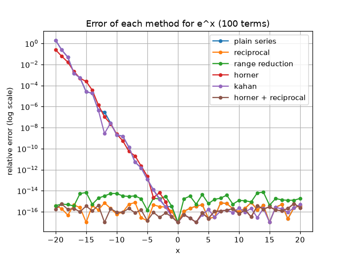

# Numerical Stability Lab

**When correct math gives wrong answers, and how to fix it.**

The Maclaurin series for e^x is exact for every x. But computed in Python
with 100 terms, it returns **6.15e-09 for x = -20, when the true value is
2.06e-09**, almost 200% wrong. This project explains why, predicts the damage
with a formula, and fixes it. Every result is checked against a 50-digit
reference computed with mpmath.



## Key findings
- **Cause:** cancellation. For x = -20 the series adds terms as large as 4.3e7
  to get an answer of 2e-9, which destroys all 16 digits a computer keeps.
- **More terms do not help.** The error flattens at a level set by the size of
  the largest term, not by how many terms you add.
- **The damage is predictable:** digits lost is about
  log10(largest term / |answer|), and the measured loss matches it.
- **What fixes it:** methods that avoid huge alternating terms (reciprocal
  trick, range reduction). Methods that only rearrange or protect the
  additions (Horner, Kahan) do not.
- **Best method:** Horner + reciprocal. Accurate for every x from -20 to 20,
  and about 1.8x faster than the plain series.

## What is inside
- Six methods for computing e^x, compared on accuracy and speed
- A diagnosis rule that tells truncation error from cancellation error
- An interactive explorer: type any x and number of terms, get the answer,
  the error and the diagnosis
- A results table (`results.csv`) with 246 measurements
- Four graphs and 12 automated tests

## Run it
```
pip install mpmath pandas matplotlib pytest
python lab.py                          # explore e^x one value at a time
python pricer.py                       # interactive option calculator
python experiments/run_experiments.py  # runs all methods, writes results.csv
python experiments/graph1.py           # also graph2.py, graph3.py, graph4.py
python experiments/graphs_phase2.py    # the four Phase 2 graphs
python -m pytest                       # 46 tests
```

## Read more
The full write-up with all four graphs is in [report.md](docs/report.md).

## Files
| File | Purpose |
|---|---|
| exp_lab.py | the six methods for computing e^x and the error function (Phase 1) |
| normal_lab.py | normal pdf and CDF: series near zero, continued fraction in the left tail |
| Black_Scholes_lab.py | Black-Scholes prices for European calls and puts |
| iv_lab.py | implied volatility solver: Newton's method with a bisection fallback |
| stats_lab.py | Welford variance, historical volatility and log-sum-exp |
| lab.py | interactive e^x explorer: type x and n, get the answer and a diagnosis |
| pricer.py | interactive option calculator: price an option or find its implied volatility |
| experiments/run_experiments.py | runs all six e^x methods and writes results.csv |
| experiments/timing.py | speed comparison of the e^x methods |
| experiments/graph1.py to graph4.py | the four Phase 1 figures |
| experiments/graphs_phase2.py | the four Phase 2 figures |
| checks/check_stage1.py to check_stage5.py | checks for each Phase 2 stage, compared against a 60-digit reference |
| checks/measure_tail.py | shows how many digits the normal CDF series loses in the left tail |
| tests/test_exp_lab.py | 12 automated tests for Phase 1 |
| tests/test_phase2.py | 34 automated tests for Phase 2 |
| docs/report.md | Phase 1 write-up |
| docs/report2.md | Phase 2 write-up |
| results.csv | measurements from run_experiments.py |
| images/ | all the graphs |
| pytest.ini | tells pytest where the tests and the code are |

## Skills demonstrated
Taylor series and convergence (ratio test), floating-point error analysis,
benchmarking against a high-precision reference, automated testing with
pytest, and data analysis and visualisation with pandas and matplotlib.

## Next
A second phase applies the same ideas to quantitative finance: a normal
CDF built from series, a Black-Scholes option pricer, and implied volatility.

## Phase 2: option pricing and statistics
Phase 2 applies the same numerical thinking to quantitative finance. Everything
is built from scratch and checked against a 60-digit reference.
- Normal CDF from a series, with a continued-fraction fix for the left tail
- Black-Scholes pricer for calls and puts
- Implied volatility solver: Newton's method with a bisection fallback
- Stable statistics: Welford variance, historical volatility, log-sum-exp
- An interactive option calculator (`python pricer.py`)
- 34 more automated tests (46 in total)

Full write-up: [report2.md](docs/report2.md)