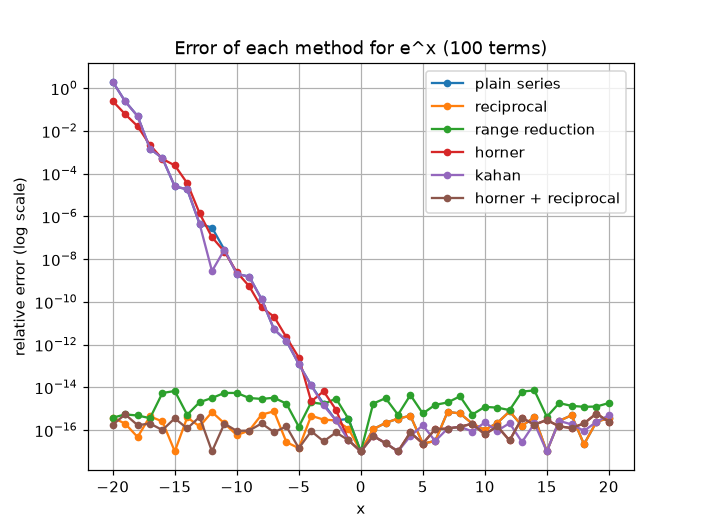
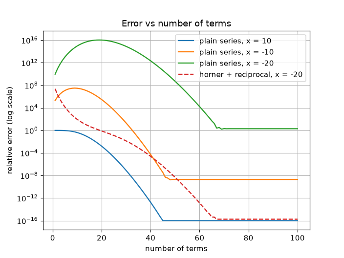
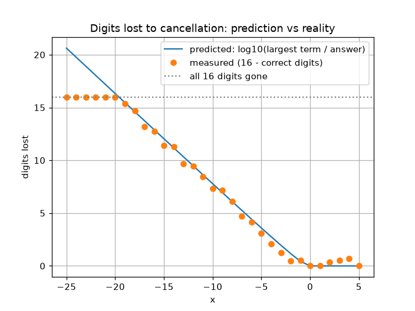
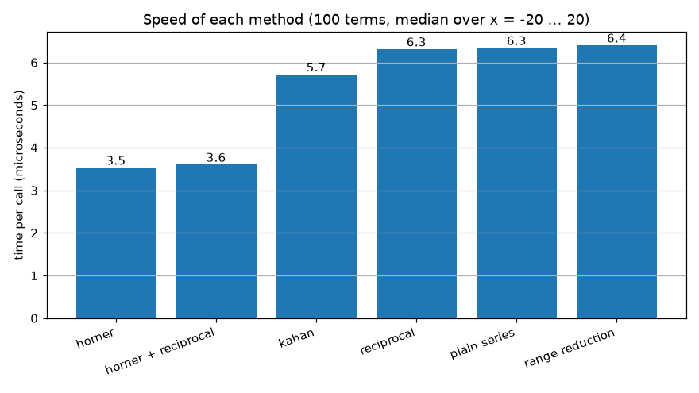

# Numerical Stability Lab: When Correct Math Gives Wrong Answers


## Summary
The Maclaurin series for e^x is mathematically exact for every x. Yet when I
coded it in Python, it returned a completely wrong answer for x = -20. This
project finds out why, measures the damage, predicts it with a formula, and
fixes it. Every result is checked against a 50-digit reference computed with
mpmath.

## The problem
For x = -20 with 100 terms, the plain series gives 6.1476e-09. The true value
is 2.0612e-09, so the relative error is 1.98 (about 200% wrong). Adding more
terms does not help: the error flattens out and the series converges to the
wrong number.

## Why it happens
The series terms grow before they shrink. For x = -20 the largest term is
about 4.31e7, but the true answer is about 2e-9. The terms alternate in sign,
so the computer adds and subtracts huge numbers to get a tiny result. A
computer keeps about 16 digits, so rounding noise of about 1e-16 x 4.3e7 is
bigger than the answer itself. This is called **cancellation**.

Two kinds of error appear in this project:
- **Truncation error**: you stopped adding terms too early. More terms fix it.
- **Cancellation error**: huge terms destroy the digits. More terms do NOT fix it.

I separate them with one test: if largest_term / |answer| > 10000, the problem
is cancellation, otherwise it is truncation.

## Methods compared (x from -20 to 20, 100 terms)
1. Plain Taylor series
2. Reciprocal trick: compute e^|x|, then take 1 / that for negative x
3. Range reduction: e^x = (e^(x/16))^16
4. Horner's method: nested form of the same polynomial
5. Kahan summation: compensated addition that tracks lost low-order digits
6. Horner + reciprocal: methods 2 and 4 combined

## Results
**Graph 1 (error vs x):** methods 1, 4 and 5 fail for negative x. At x = -20
they are wrong in the very first digit. Methods 2, 3 and 6 stay accurate
everywhere.
  

**Graph 2 (error vs number of terms):** the plain series flattens at about
1e-16 for x = 10, about 1e-8 for x = -10 and about 1 for x = -20.
The flat level is set by cancellation, not by the number of terms.
  

**Graph 3 (digits lost):** the loss is predicted by
log10(largest term / |answer|). Measured loss follows this line closely until
all 16 digits are gone (around x = -20).
  

**Graph 4 (speed):** Horner and Horner + reciprocal were the fastest
(about 3.5 microseconds per call), roughly 1.8x faster than the plain series
(about 6.3 microseconds). Kahan was in between (about 5.7). Reciprocal, plain
series and range reduction were within noise of each other. Timings vary from
run to run, so small differences are not meaningful.
  

## What I learned
- Rearranging the same sum (Horner) or protecting the additions (Kahan) does
  not fix cancellation, because the damage is already done once the huge terms
  are rounded.
- Fixes that **avoid creating huge alternating terms** work: the reciprocal
  trick (all terms positive) and range reduction (x/16 is small).
- Horner + reciprocal is both accurate and about as fast as horner, so it is the best method
  here.
- A formula can predict how many digits will be lost before running the code.

## How to run
```
pip install mpmath pandas matplotlib pytest
python run_experiments.py   # writes results.csv
python graph1.py
python graph2.py
python graph3.py
python graph4.py
python -m pytest            # runs the tests
```

## Files
- lab.py: interactive single-x explorer (type x and n, see the diagnosis)
- exp_lab.py: all six methods and the error function
- test_exp_lab.py: automated tests
- run_experiments.py: runs all methods, writes results.csv
- timing.py: speed comparison
- graph1.py, graph2.py, graph3.py: the figures; graph4.py: the speed chart