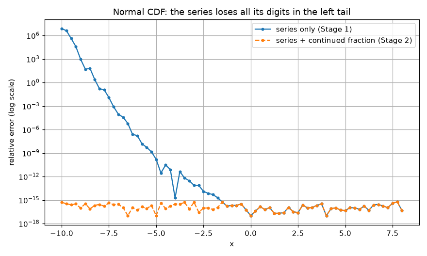
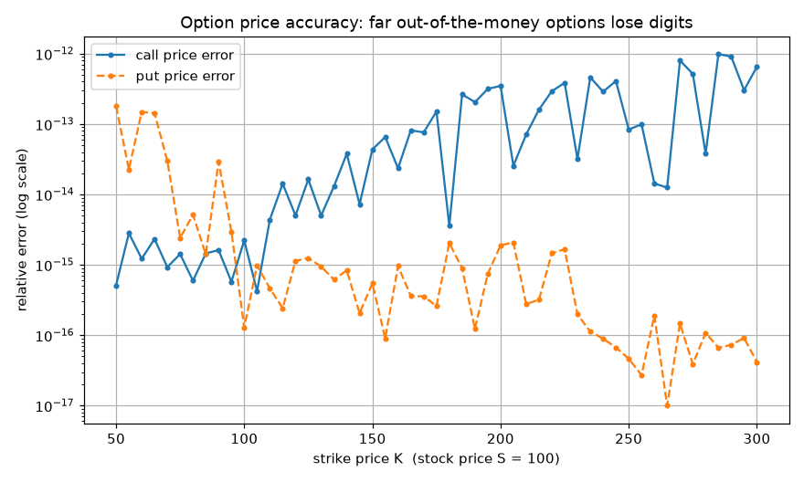
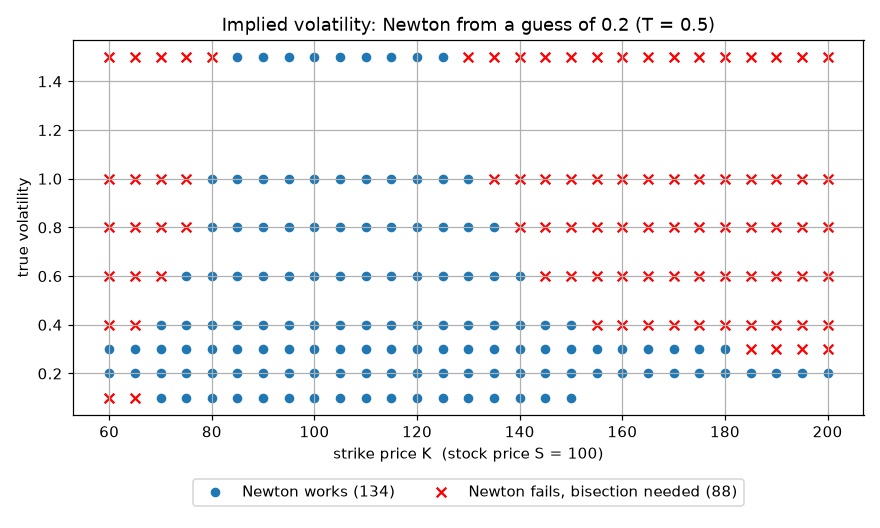
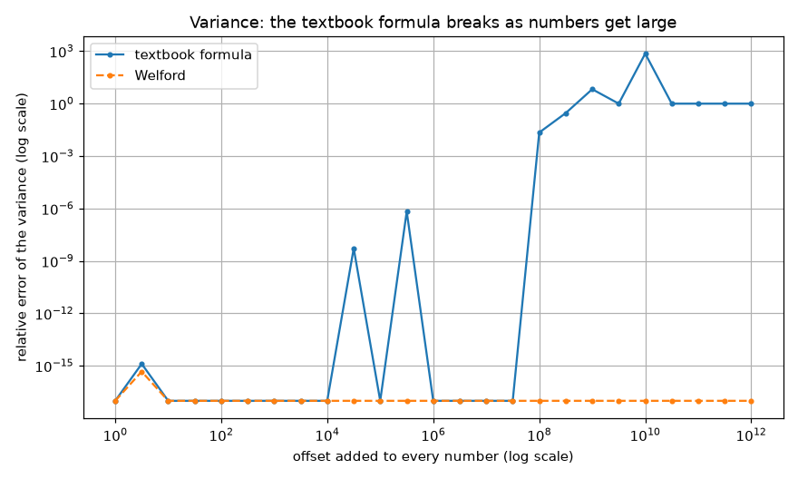

# Phase 2: Numerical Stability in Option Pricing and Statistics

Phase 1 showed that a correct formula can give a wrong answer on a computer.
Phase 2 applies the same lesson to quantitative finance: a normal CDF, the
Black-Scholes option pricer, an implied volatility solver, and three
statistics tools. Everything is built from scratch and checked against a
60-digit mpmath reference.

## 1. Normal CDF
**Method.** The series
Phi(x) = 0.5 + pdf(x) * (x + x^3/3 + x^5/(3*5) + ...), where each term is the
previous term times x^2/(2k+1).

**Problem.** For negative x the final step `0.5 + (a negative number near -0.5)`
subtracts two almost equal numbers. The error grows quickly into the tail:

| x | relative error |
|---|---|
| -3 | 7.6e-14 |
| -5 | 1.5e-10 |
| -7 | 8.9e-05 |
| -8 | 1.6e-01 |
| -10 | 7.3e+06 |

By x = -8 all 16 digits are gone, and at x = -10 the result is noise.

**Fix.** In the tail, compute the probability directly with a continued
fraction, which only adds and divides positive numbers:
Q(x) = pdf(x) / (x + 1/(x + 2/(x + 3/(x + ...)))), with Phi(-x) = Q(x).
The stable version stays at about 1e-16 from x = -20 upwards.

**Limits.** Supported for x from -20 upwards. Below -20 the function raises an
error, because e^(-x^2/2) needs more terms than the code uses. Above 8.3 it
returns exactly 1.0, which is correct to within 1e-16.

## 2. Black-Scholes pricer
**Method.** Call = S*Phi(d1) - K*e^(-rT)*Phi(d2) and the mirror formula for
the put, built from the stable Phi and the Phase 1 exponential.

**Results.** The classic case (S = K = 100, T = 1, r = 5%, sigma = 20%) gives
a call of 10.4506 and a put of 5.5735. Put-call parity holds to about 1e-14.
Near the money the error is about 1e-15.

**Finding.** Far out of the money the pricer loses 2 to 3 digits (call error
about 6.5e-13 at K = 300). Both terms of the formula are 24 to 111 times larger
than the price they produce, so the subtraction cancels digits. Those options
are worth almost nothing (1.4e-27 at K = 300), so the loss has no practical
effect.

## 3. Implied volatility
**Method.** Two solvers: bisection (always works, 43 steps) and Newton's
method (about 4 to 6 steps). The combined solver tries Newton first and falls
back to bisection.

**Problem.** Newton divides by vega. When the price curve is nearly flat,
vega is tiny and the step is enormous. Example: a put with K = 150 and T = 0.1,
started at sigma = 0.2, has vega 3e-8 and jumps to sigma = 106,925.

**Results.** In the grid below, Newton from a guess of 0.2 failed in 88 of 222
cases [check against your graph]. The combined solver recovered sigma to
about 1e-12 in the well-behaved cases (vega above 0.1).

**A different kind of limit.** For a deep in-the-money call (K = 60, true
sigma = 0.10, vega 7e-12) even bisection returns 0.0932, an error of 6.8e-3.
The price barely depends on sigma, so no method can recover it. This is
ill-conditioning of the problem, not a bug in the code. The tool warns the user
when vega is below 1e-6.

## 4. Statistics
**Variance.** The textbook formula (sum of squares minus n*mean^2) fails for
large numbers. For data 1e9 + [4, 7, 13, 16] it returns -170.67 (a negative
variance), where the true value is 30. Welford's method, which works with
small distances from a running mean, returns 30 at every offset tested.

**Historical volatility.** Log returns, Welford variance, then multiplied by
sqrt(252). On a simulated year at a true 20% the estimate was 0.1952. This is
within the expected sampling error of about 0.009, so it is a statistical
limit of one year of data, not a rounding problem.

**Log-sum-exp.** The direct formula overflows at values around 1000. Subtracting
the maximum first gives the exact answer, for example 1000.6931 for
[1000, 1000].

## 5. Tests
34 automated tests cover the four modules (46 together with the Phase 1 tests).
Several tests assert that the naive method fails, so the problem itself is
tested and not only the fix. I also checked the tests by breaking the code in
four ways; each was caught.

## 6. Limitations
- European options only, with constant volatility and no dividends.
- Normal CDF supported only for x >= -20.
- Newton's method uses a fixed starting guess of 0.2. A smarter guess would
  reduce the failures in section 3.
- Historical volatility is tested on simulated prices, not real market data.

## 7. What I learned
- The same mechanism, cancellation of nearly equal numbers, appeared in the
  exponential series, the normal CDF, the option price, and the variance.
- The fix is usually to reformulate so the subtraction never happens, not to
  add more terms or more precision.
- A problem can be ill-conditioned (the answer barely depends on the input),
  which is different from an algorithm being unstable. Both need to be
  reported honestly.
- Comparing against a high-precision reference, and testing that the naive
  methods fail, is what makes the claims checkable.